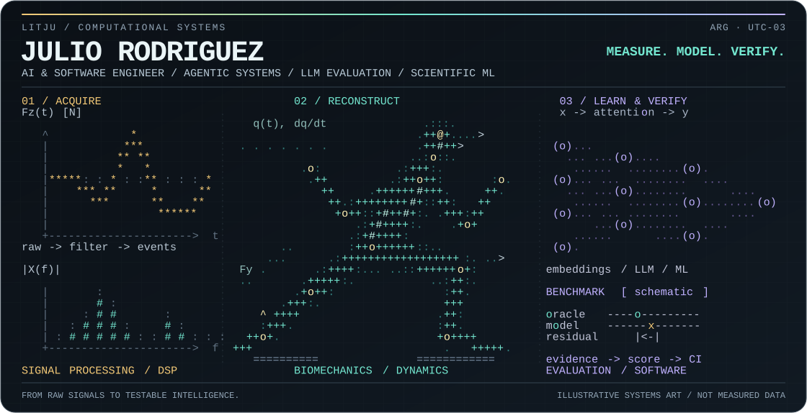
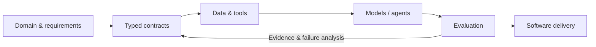
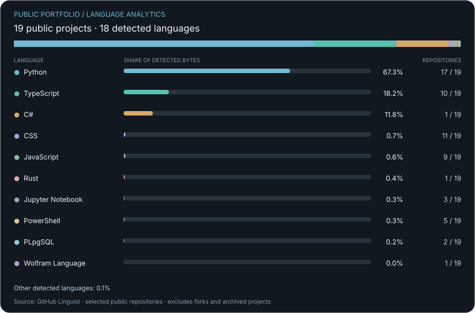

  

**AI & Software Engineer** working across agentic systems, LLM evaluation and benchmarking, scientific machine learning, and full-stack product engineering.

I build AI applications with typed tools, grounded retrieval, explicit execution boundaries and reproducible evaluation. My scientific computing work extends the same approach to simulation, measurement, numerical methods, and time-series models.

[Résumé](https://github.com/Litju/My-Curriculum-Vitae) · [Research showcase](https://fpd-bench-showcase.vercel.app) · [All repositories](https://github.com/Litju?tab=repositories)

## Featured work

### Agentic AI, RAG & evaluation

| Project | Engineering focus |
| --- | --- |
| **[DynamisRAG](https://github.com/Litju/DynamisRAG)** | Evaluation-first scientific RAG. Versioned JATS ingestion, exact passage provenance, hybrid retrieval with Qdrant and OpenSearch, Qwen3 embeddings, typed agent tools, citation verification and abstention. Research preview. |
| **[DynamisSignalBench](https://github.com/Litju/DynamisSignalBench)** | Scientific LLM and agent evaluation benchmark under development: raw sensor processing, metric calculation, evidence-grounded interpretation and decision boundaries. |
| **[Vibe Product Pal](https://github.com/Litju/Vibe-Product-Pal)** | Agentic product engineering across requirements, architecture, UX, implementation, testing and export. Web and desktop delivery with proposal-first execution. |
| **[RecruiterPal](https://github.com/Litju/RecruiterPal)** | Evidence-centered recruiting workspace with bounded tool use, persistent workflow state, retry-safe execution and human approval for consequential decisions. |

### Scientific ML, simulation & benchmarking

| Project | Engineering and research focus |
| --- | --- |
| **[Football Performance Dynamics Bench](https://github.com/Litju/football-performance-dynamics-bench)** | Conditional multi-agent motion prediction with explicit information regimes, deterministic references, DeepSets evaluation and reproducibility boundaries. Includes a bounded four-match descriptive study and interactive [research showcase](https://fpd-bench-showcase.vercel.app). |
| **[Powerlifting State Research](https://github.com/Litju/powerlifting-state-research)** | Latent-state forecasting with mechanistic simulation, probabilistic methods, temporal GRUs and comparator baselines. Synthetic research, with explicit limits on empirical validity. |
| **[DynamisBench](https://github.com/Litju/DynamisSimBench)** | Local-first workbench for simulator and controller verification, validation, uncertainty quantification and reproducible benchmarking across execution targets. |
| **[Loaded CMJ Control](https://github.com/Litju/loaded-cmj-control)** | Deterministic MuJoCo multibody simulation, hybrid feedback control, virtual force plates, isolated policy execution and reproducible trajectory evaluation. |
| **[Loaded CMJ System Identification](https://github.com/Litju/loaded-cmj-system-identification)** | Mechanics-first inverse modeling and optimization using force-platform observations and bar/linear-position kinematics. |

### Product engineering & data systems

| Project | Engineering focus |
| --- | --- |
| **[DynamisETL](https://github.com/Litju/DynamisETL)** | Multimodal data engineering with provider adapters, Parquet, DuckDB, PostgreSQL, Dagster, provenance, scientific QC and interactive analytical tools. |
| **[ShoppingPal](https://github.com/Litju/ShoppingPal)** | Agent-assisted commerce with typed shopping tools, grounded search, Medusa transactional authority, and a Next.js/FastAPI product architecture. |
| **[SecScanMonitor](https://github.com/Litju/Sec-Scan-Monitor)** | Evidence-first security engineering for AI, agent and software systems; auditable findings, policy enforcement, and explicit authority boundaries. |
| **[DynamisScience](https://github.com/Litju/DynamisScience)** | Native Python/Qt scientific workstation with reproducible analysis, dataset admission, diagnostics, evidence lineage and reporting. |

Further work: [SportsAgentsLab](https://github.com/Litju/SportsAgentsLab-Public) · [WorkoutPal](https://github.com/Litju/WorkoutPal-Public) · [DynamisLM](https://github.com/Litju/DynamisLM) (specialized reasoning-LM research; no trained checkpoint) · [BioSynGenBenchmark](https://github.com/Litju/BioSynGenBenchmark) · [Powerlifting Strength Dynamics](https://github.com/Litju/PowerliftingStrengthDynamics) · [PowerliftingSimulator](https://github.com/Litju/PowerliftingSimulator).

## Engineering capabilities

| Domain | Methods & technologies |
| --- | --- |
| **AI engineering** | LangGraph, LangChain, tool calling, MCP, RAG, embeddings, hybrid retrieval, stateful orchestration |
| **Evaluation & reliability** | Reference implementations, deterministic oracles, regression and adversarial testing, leakage controls, provenance, abstention, sandboxing |
| **ML & scientific computing** | Python, PyTorch, scikit-learn, NumPy, SciPy, statsmodels, signal processing, time-series forecasting, optimization, MuJoCo |
| **Backend & data** | FastAPI, SQL, PostgreSQL, Qdrant, OpenSearch, DuckDB, Parquet, Dagster, APIs, idempotency |
| **Software & product** | TypeScript, React, Next.js, Rust/Tauri, C#/.NET and Unity, PySide6, Docker, GitHub Actions, Vercel |

## How I build

I treat models as components of software systems, not substitutes for architecture. The surrounding system owns persistent state, permissions, deterministic computation, evidence, validation and failure behavior. In research, I distinguish numerical verification from real-world validation and keep experimental claims within their demonstrated scope.

## Language analytics

<!-- portfolio-language-stats:start -->

<!-- portfolio-language-stats:end -->

The analytics describe selected public portfolio repositories, not lines personally authored or a measure of proficiency.

## Open-source contributions

- [floodlight](https://github.com/floodlight-sports/floodlight) — sports tracking data infrastructure.
- [kloppy](https://github.com/PySport/kloppy) — provider-independent sports data parsing and representation.

## Opportunities

Open to remote AI engineering, agentic systems, LLM evaluation and benchmarking, ML engineering, backend and full-stack software roles.

[Résumé](https://github.com/Litju/My-Curriculum-Vitae) · [All repositories](https://github.com/Litju?tab=repositories)
